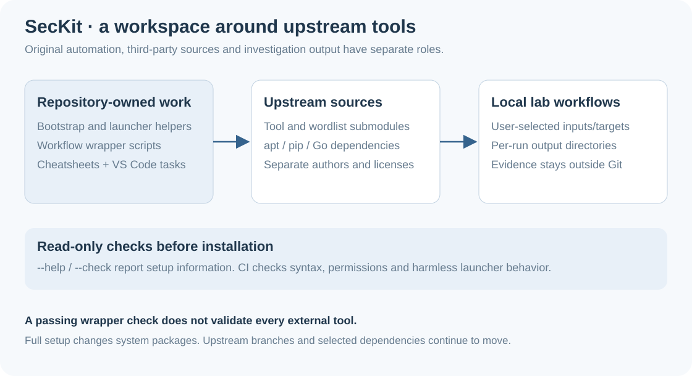

# SecKit

A personal security workspace containing shell wrappers, cheatsheets, wordlists
and pointers to third-party tools for lab work, pentesting and DFIR. The original
work here is the workspace, bootstrap and helper scripts; upstream tools retain
their own authorship and licenses.

[Setup](#setup) · [Daily commands](DAILY-USE.md) · [Workspace design](#workspace-design) ·
[Checks and limitations](docs/VERIFICATION.md)

## Setup

Use **Bash 4+** in an apt-based Linux lab environment. Bootstrap installs system
packages, Python dependencies and user-local launchers; it is more than a folder
initializer. Review it before running it on an existing workstation.

```sh
git clone https://github.com/yacrb/seckit.git
cd seckit
./bootstrap.sh --help
./bootstrap.sh --check
```

The check reports installed prerequisites and registered submodule state without
installing packages or initializing submodules. When ready to install:

```sh
./bootstrap.sh
```

Bootstrap initializes registered submodules and puts launchers in `~/bin` by
default. Add that directory to your shell's PATH if necessary.
`SECKIT_BIN_DIR` selects another launcher directory. Existing user-managed files
and symlinks are preserved. Review the final failure summary; failed steps now
produce a nonzero exit status.

## Workspace design



| Folder | Contents |
|---|---|
| `scripts/` | Original wrappers for common recon, web, DFIR and CTF workflows. |
| `cheatsheets/` | Short command references and investigation notes. |
| `tools/` | Upstream repositories, source pointers and manually managed bundles. |
| `wordlists/` | Registered SecLists and PayloadsAllTheThings submodules. |
| `.vscode/` | Workspace tasks, extension suggestions and search exclusions. |

After bootstrap, launcher names omit `.sh`: `pcap-triage`, `linux-triage`,
`subdomain-enum`, `port-scan` and `hash-crack`. To run a source file directly, use
its full repository path, for example `./scripts/forensics/pcap-triage.sh`.
The [daily-use guide](DAILY-USE.md) maps commands to workflows.

## Updates

Restore the submodule revisions recorded by this repository:

```sh
git pull
git submodule sync --recursive
git submodule update --init --recursive
```

To explicitly advance tools to their configured upstream branches:

```sh
git submodule update --init --remote --recursive
```

The existing scheduled workflow also advances upstream pointers every six hours.
That produces a moving toolkit, not a vetted release of every upstream tool.
Review changes and third-party licenses before use. Windows GUI tools remain
manual vendor downloads; [tool layout](tools/README.md) explains the categories.

## Validation

[CI](https://github.com/yacrb/seckit/actions/workflows/verify.yml) checks shell syntax,
ShellCheck errors, executable permissions and launcher behavior. It does not
install the complete toolkit or perform scans. The launcher test uses a harmless
local script and covers spaces, shell characters and preservation of existing files.

Read [verification scope](docs/VERIFICATION.md) before interpreting a green CI run.
Keep case evidence, packet captures, credentials and generated output outside Git.
